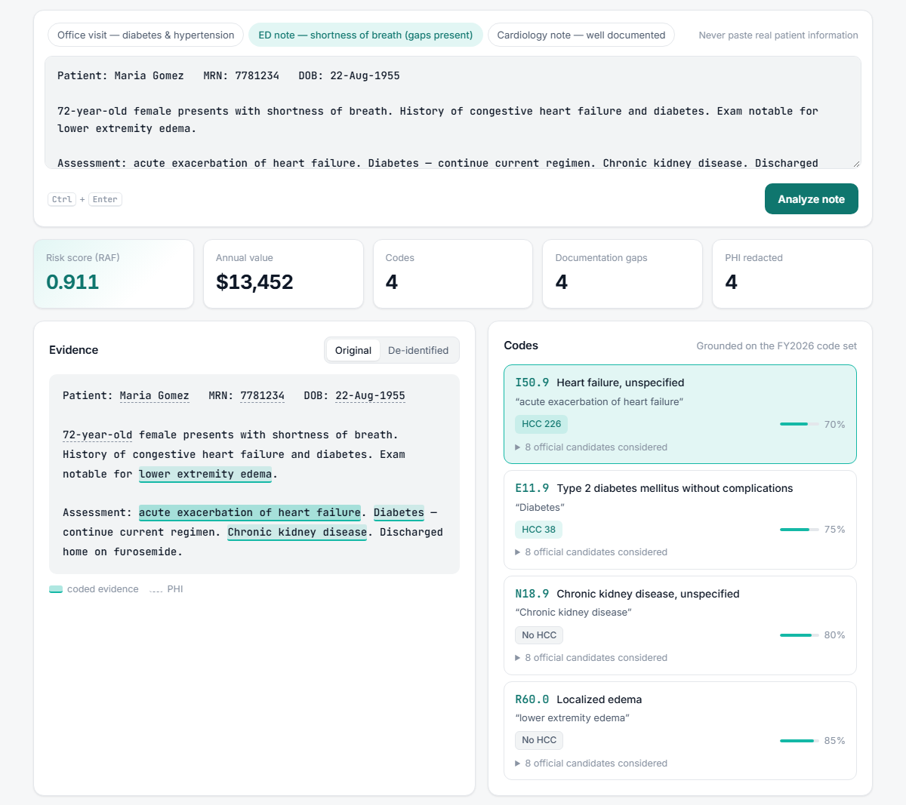
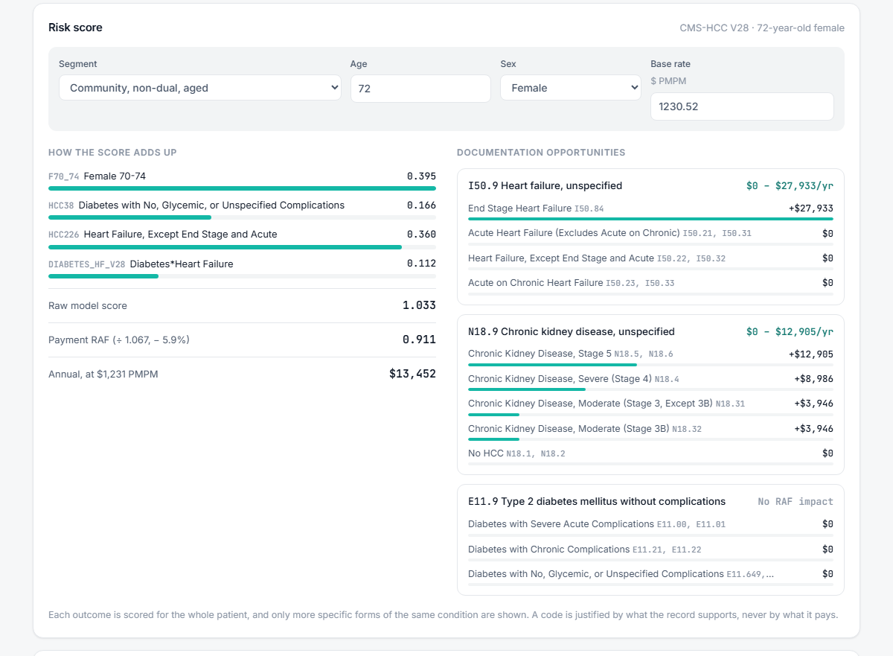

# ChartSight

[](https://github.com/Sailesh75/chartsight/actions/workflows/ci.yml)

**[Live demo](https://5zsg4er4aoovrris3vtems7kae0aoeyr.lambda-url.us-east-1.on.aws/)** · real Claude analysis, capped at 100 notes a day · synthetic notes only

**Evidence-linked HCC coding.** ChartSight is an LLM pipeline on **Amazon
Bedrock** (Anthropic Claude). It reads a clinical note and finds each diagnosis
as an **ICD-10-CM code**, along with the *exact words* in the note that support
it. It also removes **PHI**, computes the patient's **CMS-HCC V28 risk score**,
and flags **documentation gaps** that affect risk adjustment. The output is the
same kind of work that payment-integrity vendors do when they review medical
records for health plans.

<picture>
  <source media="(prefers-color-scheme: dark)" srcset="docs/screenshot-dark.png">
  
</picture>

Each highlighted phrase in the note is linked to its code card. Hover over
either one and the other lights up. Each card shows the code, its V28 HCC and
the model's confidence. Use the de-identified view to see PHI replaced with
type labels.

## Results

These numbers come from a 60-note synthetic gold set scored with Claude Haiku
4.5:

| | Single pass | **Grounded (shipped)** |
| --- | --- | --- |
| Exact ICD-10-CM code F1 | 63.9% | **80.8%** |
| Exact code precision | 72.9% | **90.2%** |
| HCC capture F1 (CMS-HCC V28) | 88.9% | **95.7%** |
| PHI recall | 100% | **100%** |
| Risk score matches CMS's own model software | | **98/98 test scores** |

**Known limitation:** gap detection flags too many notes. It finds 91–96% of
real gaps, but about half of fully documented notes also get a false flag.
Full results and caveats: [docs/pipeline.md](docs/pipeline.md#rag-grounding-on-the-official-code-set).

## How it works

1. **De-identify.** Find names, MRNs, dates and phone numbers, and redact them.
2. **Extract.** A Bedrock tool-use call returns each condition with a code, a
   confidence and the supporting text. A Pydantic schema validates the output.
3. **Ground (RAG).** BM25 retrieves real candidate codes from the official
   FY2026 code set. A second call must choose from those candidates only.
4. **Guardrail.** Any code that is not in the real ICD-10-CM set is discarded
   and shown in the UI. It is never trusted.
5. **HCC + risk score.** HCCs come straight from the CMS crosswalk, never from
   the model. The V28 score is calculated the same way as in CMS's software.
6. **Gap review.** Flag unspecified conditions and show what more specific
   documentation would be worth.

Without AWS credentials, a local rule-based engine answers instead, so the app
always runs, at no cost.

Design choices worth noting:

- **The model never sees HCCs.** If it knew which code pays, it would be pushed
  toward that code. That's upcoding, which is exactly what payment integrity
  is meant to catch.
- **Retrieval uses BM25, not embeddings.** ICD-10 descriptions are short and
  formulaic, so lexical search works well. It is also explainable, needs no
  extra dependencies, and runs in CI.
- **Opportunities stay within the same condition.** The app shows a range of
  values, not an "up to $X" headline. The calculator also showed that, under
  V28, heart-failure acuity and linked diabetes complications are both worth
  $0. Staging CKD and documenting depression severity are worth real money.

<picture>
  <source media="(prefers-color-scheme: dark)" srcset="docs/risk-dark.png">
  
</picture>

The risk panel lists every term of the V28 score, along with its coefficient.
For each unspecified code, it shows what each more specific option would be
worth per year. Change the age, sex, segment or base rate, and it re-scores
instantly without calling the model.

## Quick start

```bash
python -m venv .venv
.venv\Scripts\activate            # Windows  (macOS/Linux: source .venv/bin/activate)
pip install -e ".[api]"
chartsight serve                  # open http://localhost:8000
```

Without AWS credentials, the app runs in sample mode. Set `FORCE_MOCK=1` to
force sample mode even when credentials are present.

## Documentation

| Doc | Covers |
| --- | --- |
| [Running ChartSight](docs/usage.md) | Web UI, HTTP API, resumable batch CLI, Python client, Docker, enabling live Bedrock |
| [Coding pipeline](docs/pipeline.md) | Structured output, the code guardrail, RAG grounding, measured A/B impact, reference data |
| [Risk score](docs/risk-score.md) | The V28 RAF calculation, validation against CMS's software, how opportunities are valued |
| [Evaluation harness](docs/evaluation.md) | Synthetic gold set built by construction, metrics, how to run it |
| [Development](docs/development.md) | Lint/type/test commands, CI, project layout |
| [Deployment](infra/README.md) | Lambda + Terraform, GitHub OIDC deploys, daily cost cap |

**Deployment, in short:** the same Docker image runs on AWS Lambda behind a
Function URL. Its IAM role can call only the one Claude model. GitHub Actions
deploys with short-lived OIDC credentials. A DynamoDB counter caps live
analyses each day. Above the cap, the free sample engine answers instead.

## Synthetic data, no PHI

All notes in this project, both the UI samples and the eval gold set, are
synthetic or invented. None contain real patient data.
